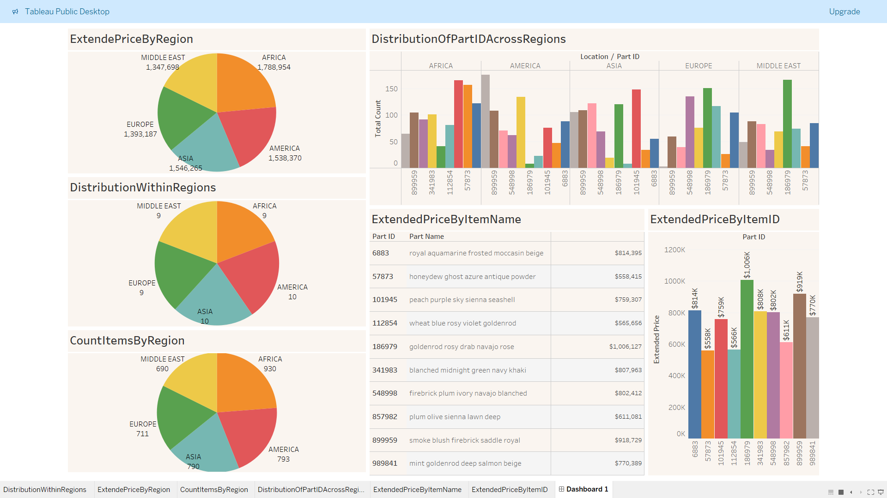
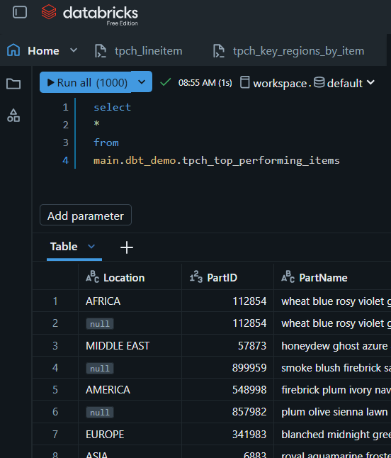

# dbt Projects

This repository uses dbt to define and build data models programmatically with
SQL and Jinja. Because the transformations are maintained as code, they can be
reviewed, tracked, and version-controlled on GitHub.

The project works with TPC-H benchmark data stored in Databricks
(`samples.tpch_sf100`). dbt builds analytical models from that data, and the
resulting data is visualized in Tableau Public.

## Data model workflow

1. Read source tables from Databricks.
2. Define transformations as dbt SQL models, using `ref()` to express
   dependencies between models.
3. Build the models in Databricks as views or tables.
4. Use the resulting data in a Tableau Public dashboard.

## Tableau Public dashboard

## Databricks query

